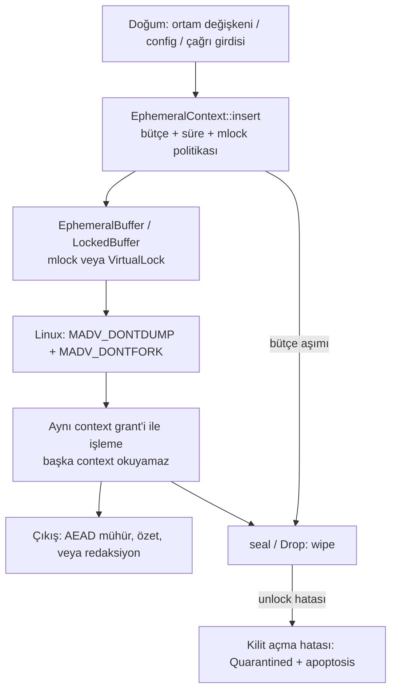

# Hassas bellek yaşam döngüsü — veri akışı ve tehdit sınırı

Bu belge `nexus-ephemera` v0.2.0 çekirdeğinin (**Aşama A–B**) garanti dilini sabitler.
İfade **"sıfır iz" değildir**. Garanti şudur: **yönetilen bellek bölgelerinde doğrulanan sıfırlama ve sınırlı veri kalıcılığı (Sensitive-Memory Lifecycle Protection)**.

## Garanti sınırları

| | |
| --- | --- |
| Kapsam içi | Core dump sızıntısı, şifresiz disk swap / pagefile kalıntısı, `fork` ile çocuk sürece sızıntı, yönetilen tamponlarda adli kalıntı |
| Kapsam dışı | Cold boot, DMA, fiziksel DRAM okuma, ayrıcalıklı `ptrace` ve çekirdek/donanım okumaları |

`mlock` alınamazsa kütüphane işlemi başlatmaz (fail-closed). Kilit alındıktan sonra kilit açma başarısız olursa bölge karantinaya alınır. `mlock` ve `madvise` ayrıcalıklı izleyiciyi veya donanım okumasını kapatmaz. `EphemeralContext::open` ve broker kabulü `harden_process_memory` çağırmadan ilerlemez.

## Veri akışı

Hassas yük (API anahtarı, token, prompt, scout düz metni) üç kapıdan girer, yönetilen kilitli tampondan başka yerde tutulmaz, çıkışta politika ve wipe kapısından geçer.

| Adım | Nerede | Ne tutulur | Ne tutulmaz |
| --- | --- | --- | --- |
| Doğum | `std::env`, yapılandırma, fonksiyon argümanı | Kaynak düz metin, çağıranın elinde, kısa ömürlü | Kütüphane bunu diske yazmaz |
| Kabul | `context::EphemeralContext` | `task_id`, politika, bütçe, tampon kimliği | Başka context'in baytları |
| İşleme | `apoptosis::EphemeralBuffer` | Sayfa hizalı kilitli kopya | Pageable ara `Vec` (kabul yolunda) |
| Çıkış | `crypto::seal_plaintext`, mesh zarfı | AEAD blob, özet, meta veri | Yönetilen tamponun düz metin dökümü |
| Kapanış | `seal`, `Drop`, apoptosis | Wipe sayacı ve yaşam durumu | Kapanmış context'i yeniden açma |

Scout ortam taraması anahtar *değerini* değil, redakte edilmiş meta veriyi taşır. Şifreleme anahtarı `crypto` oturum kasasındadır; mesh `outbound` tamponu apoptosis kancasıyla silinir.

## Aracı ve maruz kalma (Aşama C–D)

`nexus-daemon` anahtarı kendi sürecinde tutar. İstemci uç, yük özeti ve idempotency anahtarı gönderir. Aynı anahtarın tekrarı önbellekteki sonucu döner ve taşıyıcıyı yeniden çağırmaz. Sayaçlar yalnızca sayıdır; bağ özeti ve yük içermez. Unix soketi `0600` ve aynı UID artı sıfırdan büyük PID ister. Windows named pipe uzak istemciyi reddeder. Her örnek, kabul edilmeden önce yalnızca geçerli kullanıcının allow ACE'sini taşıyan bir DACL ve o kullanıcının sahipliğini alır. İstemci yazmadan önce sunucu sürecinin SID'sini doğrular. Ayrıcalıklı yönetici bu sınırın dışındadır. Bu mTLS değildir. Bağ özeti burada da MAC veya mTLS değildir. Ajan `ExecuteWithPolicy { context_id, target_endpoint, payload_hash, idempotency_key }` gönderir. Idempotency anahtarı bağ özetine karışmaz. `SecureTransactionAgent` anahtarı `EphemeralContext` içinde tutar. `Allowlist` tam uç eşleşmesi ister. Taşıyıcıya giden `AuthorizedCall` anahtar baytı içermez. Bağ özeti `SHA-256(anahtar || uç || yük özeti || nonce || zaman damgası)` değeridir. Bu bir MAC veya mTLS değildir; süreç içi IPC/API sınırıdır. `SingleUse` yetkisi taşıyıcı çağrısından önce tüketilir; panikte `Drop` kasayı siler. İşlem izni `dispatch` ve mühür bitene kadar tutulur. Fiş `seal_report` alanıyla `Complete`, `Partial` veya `Failed` sonucunu taşır; `Partial` ve `Failed` başarı değildir. `ExpiresAt` dolunca kasa kapanır. `ProviderBound` bağlı uç dışında çağrıyı reddeder. `LocalOnly` ağ çağrısına çıkmaz. `NoPlaintextExport` `Display`/`Debug` çıktısı `[REDACTED]` olur. `LogSanitizer` kayıtlı sırları log satırında `[REDACTED]` yapar ve ara kopyayı sıfırlar.

## Tehdit matrisi

| Tehdit | Savunma sınırı | Doğrulama |
| --- | --- | --- |
| Ayrıcalıklı `ptrace` / donanım okuma | Kapsam dışı. `mlock` bunu kapatmaz. Süreç içi sınır: grant'siz okuma ve apoptosis sonrası izin reddi | `isolated_contexts_cannot_read_each_other`, `read_after_apoptosis_is_denied` |
| Şifresiz swap / pagefile | `mlock` / `VirtualLock` alınmadan tampon `Active` olmaz; `RLIMIT_MEMLOCK` yükseltilemezse üretim `PrepareFailed` | `crates/memlock` `prepare` / `lock` |
| Core dump | Linux `PR_SET_DUMPABLE` + `RLIMIT_CORE=0`; `MADV_DONTDUMP` | `harden_process_memory` |
| `fork` sızıntısı | Linux `MADV_DONTFORK`: kilit aralığı çocukta eşlenmez. Çocuk baytları okunmaz; `mincore` erişim engeli döner | `run_fork_assurance_probe` (Linux yoklaması) |
| Log sızıntısı | `LogSanitizer` kayıtlı sırları `[REDACTED]` yapar; broker hataları sır taşımaz | `sanitizer_masks_registered_secret`, `agent_cannot_read_key_and_executes_only_through_broker` |
| Bütçe şişmesi | `max_bytes` sayfa yuvarlanmış kilit boyunu ve sanitizer kopyasını sayar; aşımda context kapanır | `budget_overrun_seals_context_and_wipes` |
| Kısmi kilit açma | `Quarantined`; context yeniden açılmaz; apoptosis tetiklenir | `partial_unlock_quarantines_and_blocks_reopen` |
| Cold boot / DMA / fiziksel DRAM | Bu sürümün kapsamı dışında | Belgede ve modül dokümantasyonunda açıkça dışlanır |

## EphemeralContext yaşamı

`Active` iken grant verilir. `seal`, bütçe aşımı veya `Drop` başarılı wipe ile `Closed` olur. Kilit açma veya rollback hatası `Quarantined` olur ve süreç apoptosis'ine gider. Yeni kilit tahsisi başarısız olursa, temiz kapandıysa `Failed` olur. `Closed`, `Quarantined` ve `Failed` durumlarından `Active`'e dönüş yoktur.
